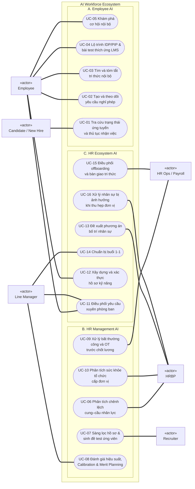
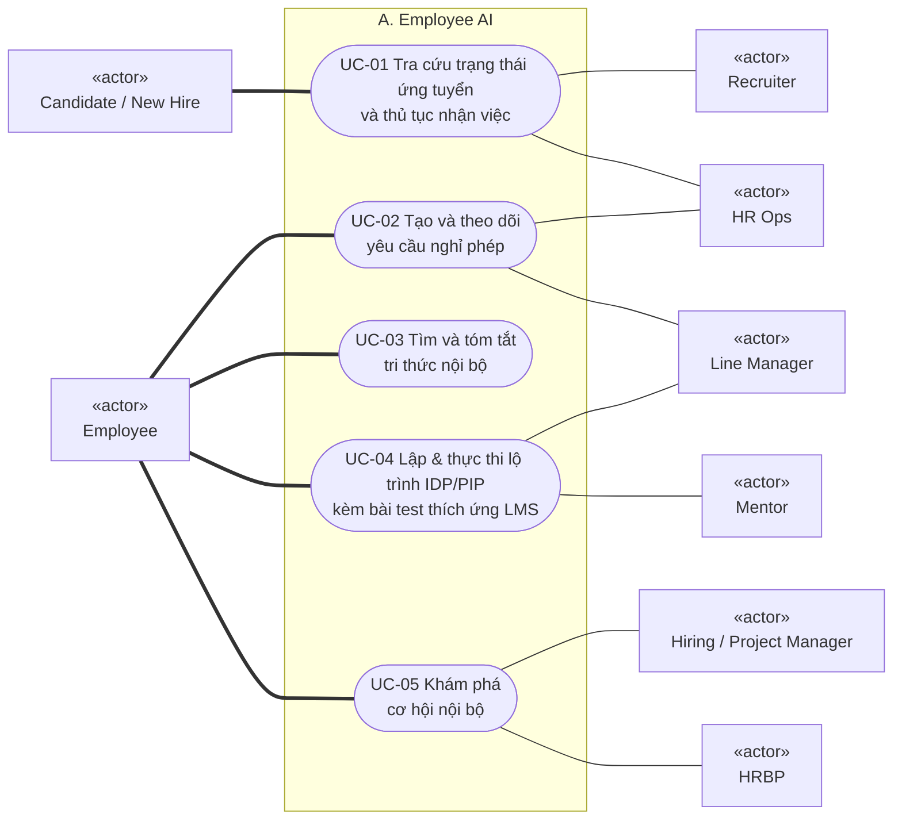
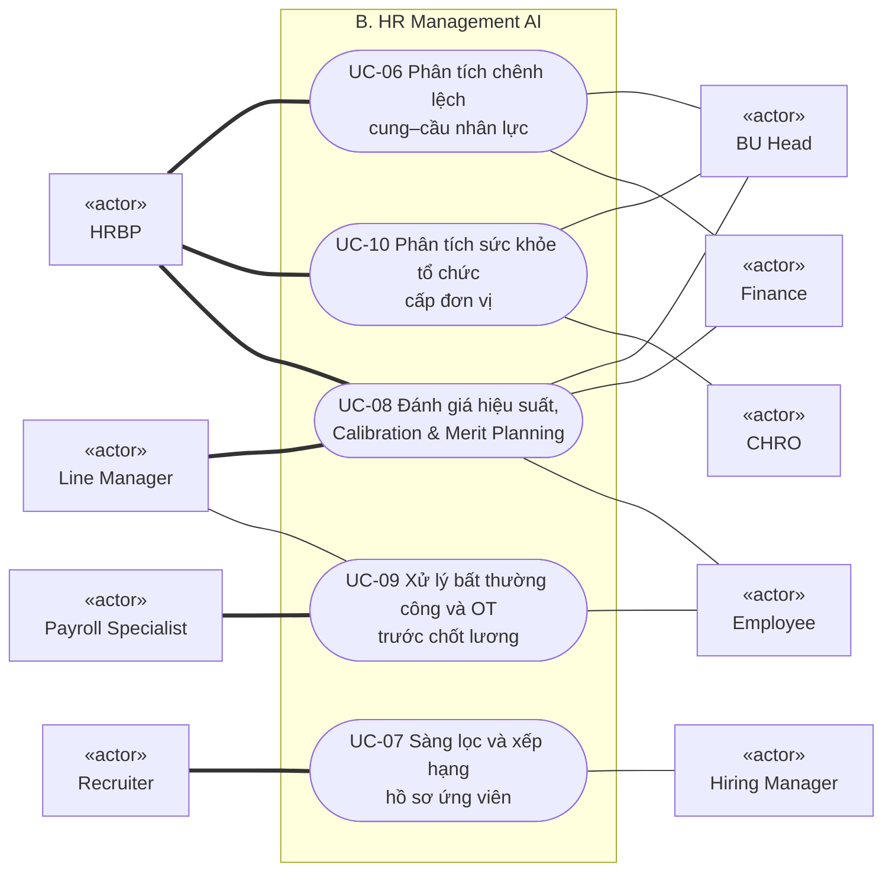
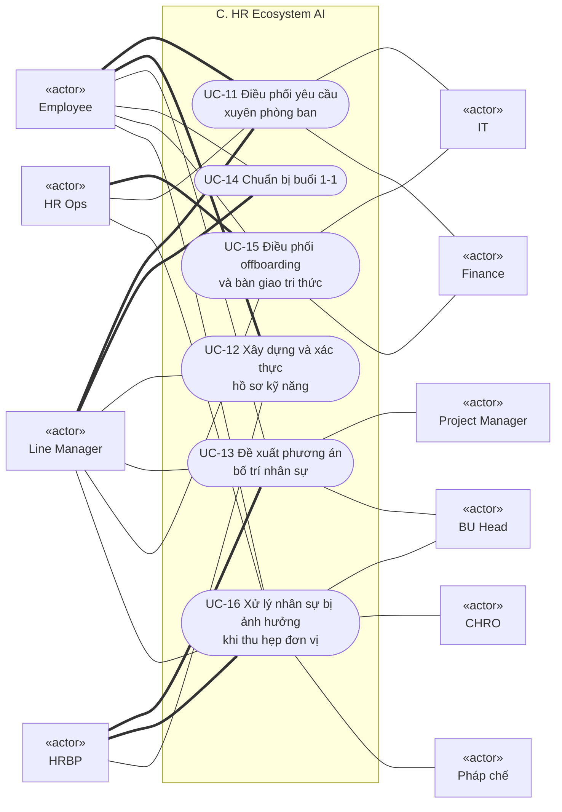
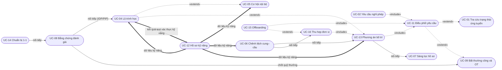

# Use case diagram

Tài liệu này vẽ quan hệ giữa actor và 16 use case trong [UC_01_Catalog.md](UC_01_Catalog.md). Đặc tả từng use case nằm ở [UC_03_Specifications.md](UC_03_Specifications.md).

Mermaid không có ký hiệu use case chuẩn UML, nên sơ đồ dùng flowchart với quy ước sau:

| Ký hiệu | Ý nghĩa |
|---|---|
| Hộp chữ nhật có nhãn «actor» | Actor |
| Hình bo tròn | Use case |
| Khung bao quanh | Ranh giới hệ thống hoặc nhóm sản phẩm |
| Đường đậm | Actor chính của use case |
| Đường thường | Actor phụ của use case |
| Mũi tên nét đứt «include» | Use case gốc luôn gọi use case được trỏ tới |
| Mũi tên nét đứt «extend» | Use case ở gốc mũi tên chỉ chạy thêm vào use case được trỏ tới khi có điều kiện |

Line Manager cũng là một Employee, nên thực hiện được mọi use case của Employee; sơ đồ không vẽ lại các đường này.

## 1. Tổng quan: actor chính và 16 use case

Actor phía nhân viên nằm bên trái, actor phía HR nằm bên phải. Thứ tự khai báo trong mã được sắp ngược để Mermaid vẽ ít đường cắt nhau nhất.

## 2. Nhóm A: Employee AI

## 3. Nhóm B: HR Management AI

## 4. Nhóm C: HR Ecosystem AI

## 5. Quan hệ giữa các use case

Sơ đồ này có thêm hai loại mũi tên không thuộc UML, dùng để thể hiện luồng giá trị giữa các use case:

- Mũi tên đậm "dữ liệu kỹ năng": use case đích đọc hồ sơ do UC-12 tạo ra.
- Mũi tên liền "nối tiếp": kết quả của use case trước là đầu vào của use case sau.

UC-03 và UC-10 không có quan hệ với use case khác nên không xuất hiện trong sơ đồ này.

| Quan hệ | Loại | Diễn giải |
|---|---|---|
| UC-02 gọi UC-11 | «include» | Yêu cầu nghỉ phép sau khi được nhân viên xác nhận luôn được chuyển cho bộ điều phối để duyệt và theo dõi |
| UC-13 gọi UC-11 | «include» | Phương án bố trí được duyệt luôn được thực hiện qua bộ điều phối: cập nhật phân bổ, quyền truy cập, thông báo |
| UC-15 gọi UC-11 | «include» | Checklist offboarding luôn chạy trên bộ điều phối |
| UC-16 gọi UC-13 | «include» | Mỗi người bị ảnh hưởng luôn được tìm phương án bố trí nội bộ trước khi xét cắt giảm |
| UC-15 mở rộng UC-16 | «extend» | Chỉ khi quyết định cắt giảm được phê duyệt thì offboarding mới khởi chạy |
| UC-11 mở rộng UC-01 | «extend» | Chỉ khi câu hỏi của ứng viên là một thủ tục cần xử lý, ví dụ đổi lịch phỏng vấn hoặc bổ sung hồ sơ |
| UC-11 mở rộng UC-09 | «extend» | Chỉ khi một bất thường cần nhân viên hoặc manager xác nhận |
| UC-04 mở rộng UC-05 | «extend» | Chỉ khi cơ hội nhân viên quan tâm còn skill gap |
| UC-04 mở rộng UC-13 | «extend» | Chỉ khi phương án bố trí khớp một phần và cần reskill |
| UC-12 cấp dữ liệu cho UC-04, 05, 06, 13 | Dữ liệu | Bốn use case này đọc hồ sơ kỹ năng; chất lượng của chúng phụ thuộc độ phủ và độ mới của hồ sơ |
| UC-04 cập nhật UC-12 | Dữ liệu | Điểm số các bài test checkpoint mốc lộ trình và test benchmark định kỳ từ LMS được cập nhật ngược vào hồ sơ kỹ năng |
| UC-06 nối tiếp UC-13 | Nối tiếp | Gap được chọn đóng bằng nội bộ trở thành nhu cầu nhân lực để tìm phương án bố trí |
| UC-06 nối tiếp UC-16 | Nối tiếp | Khi phân tích cung–cầu dẫn tới quyết định thu hẹp, danh sách vị trí dư trở thành đầu vào của UC-16 |
| UC-13 nối tiếp UC-07 | Nối tiếp | Khi không có phương án nội bộ, nhu cầu chuyển sang tuyển ngoài (kèm sinh đề test ứng viên theo role) |
| UC-14 nối tiếp UC-08 | Nối tiếp | Ghi chú 1:1 và tiến độ action items được gom làm bằng chứng đánh giá |
| UC-08 nối tiếp UC-04 | Nối tiếp (Lộ trình) | Kết quả xếp loại tự động kích hoạt lập lộ trình IDP cho loại A (cán bộ nguồn/kế nhiệm) hoặc bản cam kết PIP 90 ngày cho loại C |
| UC-08 nối tiếp UC-09 | Nối tiếp | Kết quả phân bổ quỹ thưởng sau khi Hội đồng HR duyệt được chuyển sang Payroll để chi trả kỳ cuối năm |
