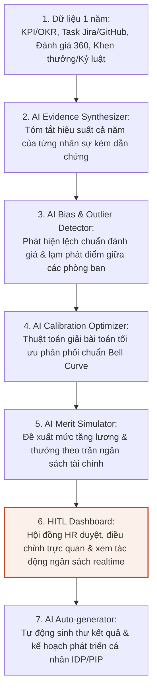
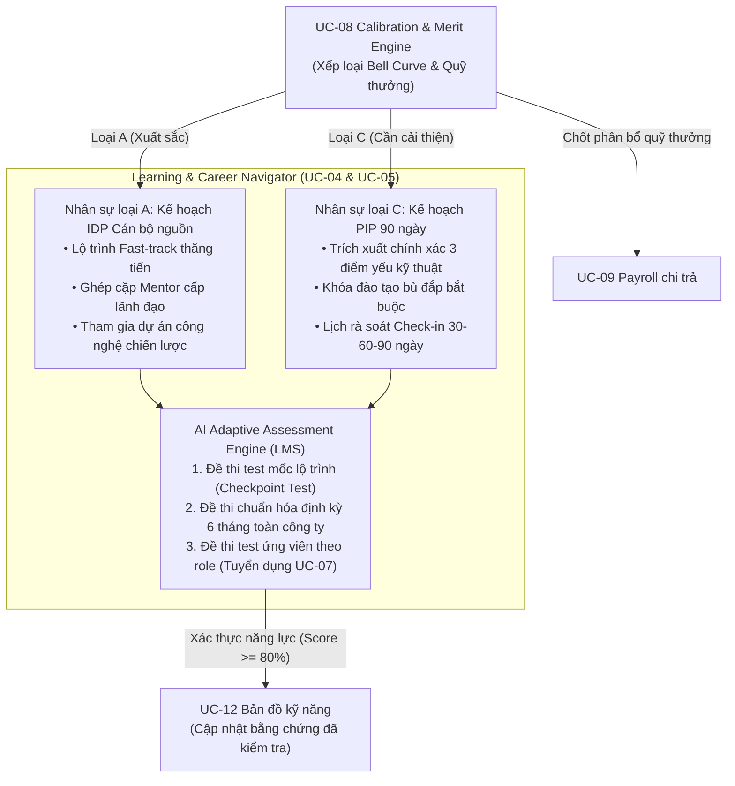

# UC-08 Deep Dive: AI Performance Calibration & Merit Planning Engine

> **Hệ thống AI Điều phối Đánh giá Hiệu suất, Cân bằng Phân phối Chuẩn & Phân bổ Quỹ Thưởng**  
> *Áp dụng cho quy mô tập đoàn lớn từ 5.000 – 20.000 nhân sự*

---

## 1. Bối cảnh & Tại sao bài toán này "rất to"?

Trong các tập đoàn và doanh nghiệp quy mô lớn (như VinGroup, Vinsmart Future), kỳ đánh giá hiệu suất cuối năm (**Year-end Performance Review**) và xét duyệt tăng lương thưởng (**Merit Planning**) là một trong những hoạt động quản trị chiến lược tốn kém thời gian và áp lực nhất:
- **Thời gian kéo dài:** Thường tiêu tốn từ 2 đến 3 tháng của toàn bộ đội ngũ quản lý, HR và Ban Giám đốc.
- **Ngân sách khổng lồ:** Toàn bộ quỹ thưởng hàng chục đến hàng trăm tỉ đồng và chính sách tăng lương năm tới phụ thuộc hoàn toàn vào kết quả của kỳ này.
- **Tác động trực tiếp tới sự gắn kết:** Sai lệch trong đánh giá và phân bổ đãi ngộ là nguyên nhân số 1 dẫn đến làn sóng nhảy việc sau Tết của các nhân sự chủ chốt (Top Talents).

---

## 2. Ba "Điểm đau" (Painpoints) thực tế

```
+-----------------------------------------------------------------------------------+
|  1. LẠM PHÁT ĐIỂM SỐ (RATING INFLATION)                                           |
|  - Trưởng phòng dễ dãi: Chấm 90% nhân viên loại A (Xuất sắc) để giữ hòa khí.      |
|  - Trưởng phòng nghiêm khắc: Chỉ chấm 20% loại A dù đội ngũ cày dự án sống chết.  |
|  -> Bất công nội bộ, nhân sự giỏi nản lòng, so bì và nghỉ việc.                   |
+-----------------------------------------------------------------------------------+
|  2. ĐÁNH GIÁ CẢM TÍNH & THIẾU BẰNG CHỨNG (RECENCY BIAS)                           |
|  - Quản lý chỉ nhớ sự việc xảy ra trong 2-4 tuần gần nhất.                       |
|  - Bỏ quên toàn bộ công sức, dự án gian khổ trong 11 tháng trước đó.              |
|  -> Quyết định phiến diện, thiếu dữ liệu định lượng có nguồn gốc.                 |
+-----------------------------------------------------------------------------------+
|  3. HỌP CALIBRATION KIỆT SỨC & RỦI RO VỠ TRẦN NGÂN SÁCH (MERIT CEILING)           |
|  - HR và Giám đốc khối phải họp cãi nhau hàng chục buổi để "ép" Bell Curve.       |
|  - Tính toán ma trận thưởng (Merit Matrix) thủ công bằng Excel, dễ vỡ trần quỹ.   |
|  -> Mệt mỏi, tốn kém hàng nghìn giờ công, kết quả phụ thuộc vào ai "to mồm" hơn. |
+-----------------------------------------------------------------------------------+
```

---

## 3. Kiến trúc AI Automation Workflow (7 bước)

Hệ thống vận hành theo chu trình khép kín kết hợp giữa tự động hóa AI và điểm chạm con người (**Human-in-the-loop**):



### Chi tiết từng bước thực thi:

### Bước 1: Thu thập dữ liệu hiệu suất 1 năm (Data Ingestion)
- **Nguồn dữ liệu:**
  - Hệ thống OKR/KPI: Tiến độ hoàn thành mục tiêu, trọng số từng key result.
  - Hệ thống quản lý công việc: Jira tickets, task commits, Pull Requests (PRs) trên GitHub/GitLab, độ phức tạp của module đảm nhận.
  - Đánh giá 360 độ: Peer review chéo từ đồng nghiệp, đối tác dự án, cấp dưới.
  - Hồ sơ nhân sự: Điểm danh, thưởng nóng dự án, ghi nhận khách hàng, vi phạm kỷ luật.

### Bước 2: AI Evidence Synthesizer (Tổng hợp bằng chứng cả năm)
- **Cơ chế:** Phân tích toàn bộ dữ liệu 12 tháng, liên kết công việc thực tế với mục tiêu ban đầu.
- **Giá trị cốt lõi:** Loại bỏ triệt để **Recency Bias**. Mỗi nhận định trong bản nháp đánh giá đều đi kèm bằng chứng cụ thể (ví dụ: *"Hoàn thành tối ưu Payment API vượt chỉ tiêu P95 trong đợt load test tháng 05/2026; dẫn dắt 2 kỹ sư mới trong Q3"*).

### Bước 3: AI Bias & Outlier Detector (Phát hiện lệch chuẩn & lạm phát điểm)
- **Cơ chế:** So sánh phân phối điểm tự chấm của từng Trưởng phòng với output công việc thực tế trên hệ thống.
- **Phát hiện:**
  - **Rating Inflation:** Trưởng phòng A chấm 90% loại A nhưng khối lượng task hoàn thành trung bình của team thấp hơn 15% so với mức trung bình khối.
  - **Overly Strict Manager:** Trưởng phòng B chấm 20% loại A trong khi team có chỉ số đóng góp kỹ thuật thuộc top 10% tập đoàn.
  - **Gắn cờ ngoại lệ (Edge Cases):** Cảnh báo trường hợp nhân viên được chấm loại A nhưng bằng chứng đóng góp thấp hơn 30% so với mặt bằng chung loại A của khối.

### Bước 4: AI Calibration Optimizer (Tối ưu hóa phân phối chuẩn Bell Curve)
- **Cơ chế:** Áp dụng thuật toán tối ưu ràng buộc (Constrained Optimization) để khớp dữ liệu về đường cong phân phối chuẩn (ví dụ: Top 10% A - Xuất sắc, 70% B - Đạt yêu cầu, 20% C - Cần cải thiện).
- **Giá trị:** Đề xuất kịch bản dịch chuyển xếp loại công bằng, minh bạch dựa trên trọng số bằng chứng xuyên phòng ban, không phụ thuộc vào cảm tính của người chấm.

### Bước 5: AI Merit Simulator (Mô phỏng tăng lương & thưởng theo ngân sách)
- **Cơ chế:** Tính toán ma trận thưởng (**Merit Matrix**) dựa trên xếp loại sau calibration kết hợp với vị trí lương thị trường (**Compa-Ratio**).
- **Ràng buộc cứng:** Tổng chi phí lương mới và tiền thưởng phải luôn $\le$ Trần ngân sách tài chính được cấp bởi Finance.

### Bước 6: HITL Dashboard cho Hội đồng HR (Human-in-the-loop)
- **Giao diện trực quan:** Hội đồng HR (HRBP, Giám đốc khối BU Head, Line Manager) theo dõi biểu đồ Bell Curve và chi phí ngân sách cập nhật tức thời (realtime).
- **Tập trung vào ngoại lệ:** Hội đồng không cần rà soát tay hàng nghìn hồ sơ bình thường, mà chỉ tập trung xử lý các hồ sơ do AI gắn cờ cảnh báo kèm lý lẽ phản biện.
- **Quyền quyết định tuyệt đối:** Hội đồng kéo-thả để điều chỉnh xếp loại nhân sự. Hệ thống tính toán ngay tác động đến phân phối chuẩn và phần trăm quỹ thưởng còn lại.

### Bước 7: AI Auto-generator (Sinh thư kết quả & kế hoạch IDP/PIP)
- **Thư thông báo kết quả:** Tự động cá nhân hóa thư gửi nhân viên, ghi nhận đóng góp nổi bật và giải thích minh bạch lý do xếp loại cùng mức lương/thưởng mới.
- **Tích hợp lộ trình phát triển nhân sự (nối với UC-04 Learning & Skill Growth Coach):**
  - **Nhân sự loại A (Xuất sắc):** Tự động sinh **Kế hoạch phát triển cá nhân (IDP - Individual Development Plan)**, đưa vào diện quy hoạch cán bộ nguồn / kế nhiệm (**Succession Pipeline**), đề xuất khóa học quản lý hoặc trao quyền phụ trách sáng kiến công nghệ mới.
  - **Nhân sự loại C (Cần cải thiện):** AI tự động trích xuất đúng **3 điểm yếu lớn nhất** trong năm và thiết lập bản cam kết **Kế hoạch cải thiện hiệu suất (PIP - Performance Improvement Plan)** trong 90 ngày với các mốc rà soát rõ ràng (30-60-90 ngày).

---

## 4. Nguyên tắc thiết kế Human-in-the-loop (HITL)

> [!IMPORTANT]
> **AI đóng vai trò Người phản biện độc lập (Independent Reviewer), không phải Người ra quyết định (Decision Maker).**

- **AI phản biện độc lập:**  
  *"Quản lý chấm nhân viên Nguyễn Văn A loại A, nhưng bằng chứng đóng góp thực tế trên hệ thống (task Jira, commits, feedback 360) thấp hơn 30% so với mặt bằng chung loại A của khối Digital Products."*
- **Con người quyết định:**  
  Hội đồng HR lắng nghe giải trình của Quản lý, đối chiếu bằng chứng bổ sung và bấm nút phê duyệt hoặc điều chỉnh. AI không tự ý đổi điểm hay hạ lương của nhân viên.
- **Tiết kiệm nguồn lực:**  
  Thay vì mất 20 buổi họp với hàng chục lãnh đạo ngồi cãi nhau từng hồ sơ, Hội đồng HR chỉ dành 2 buổi để xử lý 5–7% số ca ngoại lệ do AI gắn cờ cảnh báo.

---

## 5. Tích hợp sâu vào Learning & Career Navigator & Động cơ Đề thi thích ứng qua LMS

Hệ thống kết nối trực tiếp với **Learning & Career Navigator** ([UC-04](UC_03_Specifications.md#uc-04-lập--thực-thi-lộ-trình-phát-triển-cá-nhân-idp--pip-kèm-bài-kiểm-tra-thích-ứng-qua-lms) & [UC-05](UC_03_Specifications.md#uc-05-khám-phá-và-bày-tỏ-quan-tâm-tới-cơ-hội-nội-bộ)) để biến kết quả đánh giá thành hành động phát triển thực tế, đồng thời tích hợp **AI Adaptive Assessment Engine** (sinh đề thi tự động qua LMS):



### 1. Cơ chế thực thi IDP và PIP qua Learning & Career Navigator
- **Đối với Nhân sự loại A (Cán bộ nguồn / Succession Pipeline):**
  - Không dừng lại ở việc nhận thưởng cao, hệ thống tự động đưa nhân sự vào nhánh phát triển tài năng trẻ (*Fast-track Track*).
  - Learning & Career Navigator tự động đề xuất các cơ hội luân chuyển dự án chiến lược (UC-05), ghép cặp với Mentor là BU Head / Technical Director, và giao các bài toán kiến trúc hệ thống cấp cao.
- **Đối với Nhân sự loại C (Kế hoạch cải thiện hiệu suất 90 ngày - PIP):**
  - AI trích xuất chính xác 3 điểm yếu kỹ thuật/quy trình trong năm (ví dụ: *Kỹ năng tối ưu truy vấn cơ sở dữ liệu, Tuân thủ quy chuẩn viết unit test, Kỹ năng phối hợp liên bộ phận*).
  - Tự động lập bản cam kết đào tạo trong 90 ngày trên LMS, gửi thông báo lịch check-in 30-60-90 ngày cho Line Manager và HRBP để theo sát.

### 2. Động cơ Sinh Đề thi Kiểm tra Thích ứng (AI Adaptive Assessment Engine)
Hệ sinh thái giải quyết bài toán kiểm chứng năng lực thực tế qua 3 loại bài test tự động:
1. **Đề thi test ứng viên theo role (Candidate Adaptive Assessment - UC-07):**
   - Đọc JD và CV ứng viên để tự động sinh đề test kỹ thuật (coding/system design/case study) theo cấp bậc, chấm điểm tự động và đính kèm báo cáo năng lực trước khi phỏng vấn.
2. **Đề thi test mốc hoàn thành lộ trình (Milestone Checkpoint Test - UC-04):**
   - Sau mỗi khóa học trong lộ trình IDP/PIP, AI sinh bài kiểm tra thực hành thích ứng qua LMS. Chỉ khi ứng viên đạt $\ge 80\%$, mốc lộ trình mới được phê duyệt hoàn thành.
3. **Đề thi test định kỳ chuẩn hóa năng lực công ty (Periodic Competency Benchmark):**
   - 6 tháng một lần, AI tự động tạo các đề kiểm tra chuyên môn đồng bộ qua LMS cho toàn công ty, tự động cập nhật độ tin cậy của kỹ năng vào Bản đồ kỹ năng (UC-12).

---

## 6. Bảng so sánh Trước và Sau khi ứng dụng AI (Before vs After)

| Tiêu chí | Trước khi có AI (Quy trình cũ) | Sau khi có AI Calibration & Merit Engine |
|---|---|---|
| **Thời gian chu kỳ Year-end** | 2 – 3 tháng căng thẳng | 1 – 2 tuần khép kín quy trình |
| **Bằng chứng đánh giá** | Cảm tính, Recency Bias (nhớ 2 tuần gần nhất) | 100% khách quan, tổng hợp 12 tháng từ KPI, Jira, 360 |
| **Lạm phát điểm số** | Thường xuyên xảy ra giữa các phòng ban | Phát hiện tức thời qua Bias & Outlier Detector |
| **Cân bằng Bell Curve** | Họp cãi nhau hàng chục buổi, áp đặt ý chí | Thuật toán tối ưu hóa phân phối chuẩn dựa trên trọng số |
| **Quản trị ngân sách thưởng** | Tính Excel thủ công, dễ vỡ trần tài chính | Mô phỏng realtime, khóa chặt theo trần ngân sách (Hard ceiling) |
| **Hành động sau đánh giá** | Chỉ có điểm số và tiền thưởng, thiếu lộ trình | Tự động sinh IDP cho cán bộ nguồn A và PIP 90 ngày cho loại C |
| **Trải nghiệm nhân viên** | Nghi ngờ, bất mãn, dễ nhảy việc sau Tết | Rõ ràng, minh bạch, có lộ trình phát triển cụ thể |
