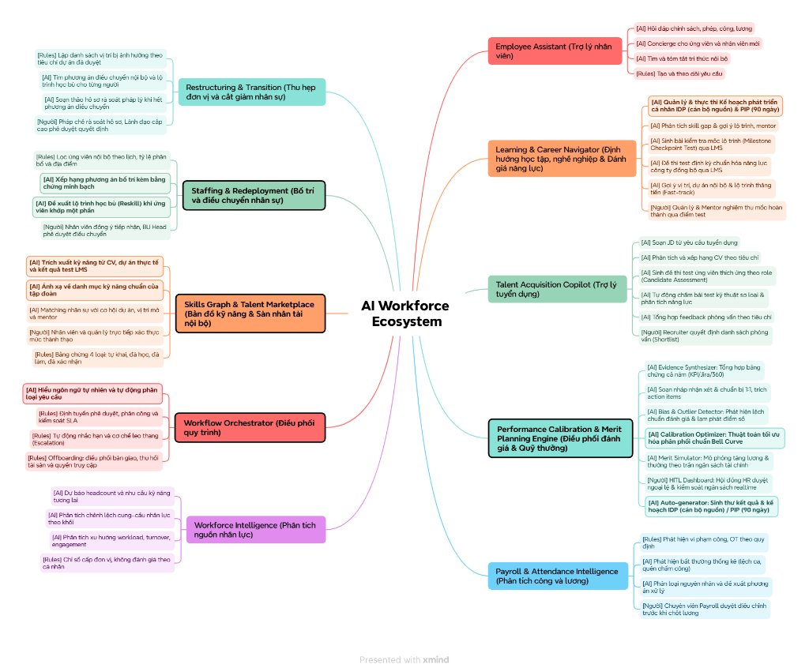
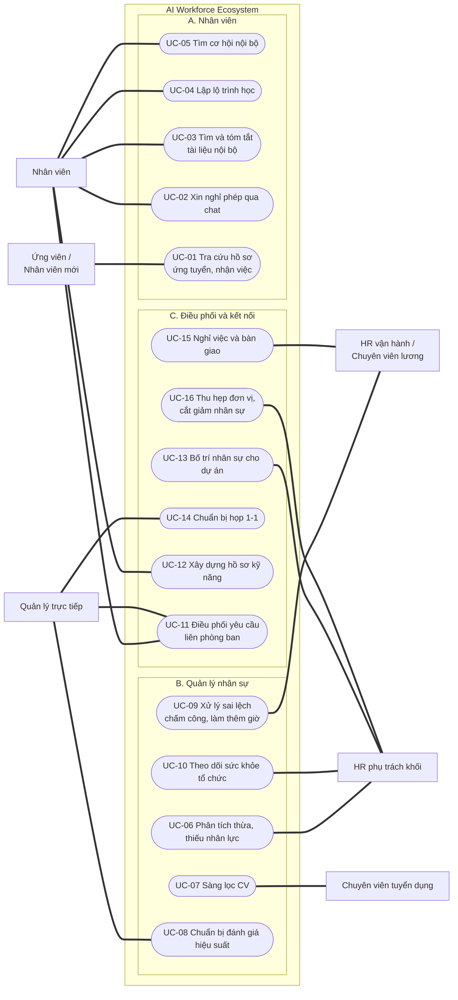

# AI Workforce Ecosystem: Tài liệu

Bộ tài liệu cho hệ sinh thái AI hỗ trợ nhân viên, HR và lãnh đạo trong một tập đoàn IT lớn.

## Cấu trúc

```text
docs/
├── 01-overview/            Bối cảnh, bài toán, mục tiêu
├── 02-product-mindmap/     Feature và thành phần sản phẩm
└── 03-use-cases/           Danh mục, sơ đồ, đặc tả use case
```

## 1. Overview

**Bối cảnh** tập đoàn IT lớn liên tục mở rộng và tái cấu trúc : dự án, nhân lực kém hiểu quả cắt bỏ nhanh.bài toán bọn em đưa ra để phân tích các use case là tạo hệ thống AI hỗ trợ toàn bộ vòng đời của nhân sự làm việc, đào tạo, phát triển, luân chuyển cho đến nghỉ việc.


**Bài toán:** xây dựng AI-powered Workforce Ecosystem giúp nhân viên làm việc hiệu quả hơn, đồng thời hỗ trợ HR và lãnh đạo quản trị, phân bổ và tối ưu nguồn nhân lực toàn tập đoàn.

| Mục tiêu | Ý nghĩa |
|---|---|
| Empower Employees | Giúp nhân viên tự giải quyết nhu cầu, thực hiện công việc, tiếp cận tri thức,tài liệu công ty, phát triển kỹ năng và nâng cao năng suất, lộ trình sự nghiệp; giảm thao tác thủ công và phụ thuộc vào HR. |
| Augment HR & Management | Hỗ trợ HR, Manager và lãnh đạo quản trị nguồn nhân lực, phân tích dữ liệu, ra quyết định, chuẩn hóa quy trình và giảm tải vận hành |
| Automate Workflows | Chuẩn hóa và tự động hóa quy trình xuyên phòng ban |
| Optimize Workforce | Khai thác kỹ năng nội bộ, điều chuyển linh hoạt, giữ chân nhân tài |


Chi tiết: [AI_Workforce_Ecosystem.md](01-overview/AI_Workforce_Ecosystem.md)

## 2. Product mindmap

10 feature chính; mỗi nhánh gồm thành phần AI và điểm con người quyết định.



| File | Nội dung |
|---|---|
| [Product_Mindmap.md](02-product-mindmap/Product_Mindmap.md) | Mindmap dạng outline |
| [Product_Mindmap_Detail.md](02-product-mindmap/Product_Mindmap_Detail.md) | Giải thích từng thành phần, gắn nhãn `[AI]`, `[Rules]`, `[Người]` |
| [Product_Mindmap.html](02-product-mindmap/Product_Mindmap.html) | Bản HTML (mở bằng trình duyệt) |

## 3. Use case

16 use case, chia 3 nhóm: **A. Nhân viên** (UC-01 đến 05), **B. Quản lý nhân sự** (UC-06 đến 10), **C. Điều phối và kết nối** (UC-11 đến 16). Quản lý trực tiếp cũng là nhân viên nên làm được mọi việc của nhân viên.



| ID | Use case | Người thực hiện | Người liên quan | Luồng |
|---|---|---|---|---|
| UC-01 | Tra cứu hồ sơ ứng tuyển, nhận việc | Ứng viên, nhân viên mới | Tuyển dụng, HR vận hành | Hỏi → AI tra hồ sơ → trả lời kèm việc còn thiếu |
| UC-02 | Xin nghỉ phép qua chat | Nhân viên | Quản lý trực tiếp | Mô tả nhu cầu → kiểm tra số ngày phép → quản lý duyệt |
| UC-03 | Tìm và tóm tắt tài liệu nội bộ | Nhân viên | Không có | Hỏi → tìm tài liệu được phép xem → AI tóm tắt kèm nguồn |
| UC-04 | Lập lộ trình học | Nhân viên | Quản lý trực tiếp, người hướng dẫn | Chọn mục tiêu → xác định kỹ năng thiếu → AI gợi ý khóa học |
| UC-05 | Tìm cơ hội nội bộ | Nhân viên | Quản lý dự án, HR phụ trách khối | Nêu nguyện vọng → AI gợi ý vị trí phù hợp → đăng ký quan tâm |
| UC-06 | Phân tích thừa, thiếu nhân lực | HR phụ trách khối | Trưởng khối, Tài chính | Tổng hợp người có và người cần → AI đề xuất cách bù → trình trưởng khối |
| UC-07 | Sàng lọc CV | Chuyên viên tuyển dụng | Quản lý cần tuyển | AI chấm CV kèm lý do → tuyển dụng chốt danh sách |
| UC-08 | Chuẩn bị đánh giá hiệu suất | Quản lý trực tiếp | Nhân viên, HR phụ trách khối | Gom bằng chứng → AI soạn nháp → quản lý sửa và xếp loại |
| UC-09 | Xử lý sai lệch chấm công, làm thêm giờ | Chuyên viên lương | Nhân viên, quản lý trực tiếp | Quét dữ liệu công → phát hiện sai lệch → xác nhận, sửa → chốt lương |
| UC-10 | Theo dõi sức khỏe tổ chức | HR phụ trách khối | Trưởng khối, Giám đốc nhân sự | Tính chỉ số theo nhóm → AI giải thích biến động → chọn hành động |
| UC-11 | Điều phối yêu cầu liên phòng ban | Nhân viên, quản lý trực tiếp | HR vận hành, IT, Tài chính | Nhận yêu cầu → giao người, đặt hạn → nhắc việc → hoàn tất |
| UC-12 | Xây dựng hồ sơ kỹ năng | Nhân viên | Quản lý trực tiếp | AI rút kỹ năng từ CV, dự án → nhân viên xác nhận → quản lý xác thực |
| UC-13 | Bố trí nhân sự cho dự án | HR phụ trách khối | Quản lý dự án, trưởng khối, nhân viên | AI gợi ý người phù hợp → nhân viên đồng ý → trưởng khối duyệt |
| UC-14 | Chuẩn bị họp 1-1 | Quản lý trực tiếp | Nhân viên | AI tóm tắt tình hình, gợi ý chủ đề → họp → theo dõi việc cần làm |
| UC-15 | Nghỉ việc và bàn giao | HR vận hành | Nhân viên nghỉ việc, IT, Tài chính | Tạo checklist → bàn giao công việc → thu hồi tài sản, quyền → quyết toán |
| UC-16 | Thu hẹp đơn vị, cắt giảm nhân sự | HR phụ trách khối | Trưởng khối, Giám đốc nhân sự, pháp chế, nhân viên | Lập danh sách bị ảnh hưởng → AI tìm vị trí nội bộ, học bù → hết phương án thì pháp chế rà soát → Giám đốc nhân sự duyệt → nghỉ việc và bàn giao |

| File | Nội dung |
|---|---|
| [UC_01_Catalog.md](03-use-cases/UC_01_Catalog.md) | Bảng 16 use case, actor, phân vai AI/rules/người |
| [UC_02_Diagrams.md](03-use-cases/UC_02_Diagrams.md) | Sơ đồ theo từng nhóm và quan hệ include/extend |
| [UC_03_Specifications.md](03-use-cases/UC_03_Specifications.md) | Đặc tả chi tiết từng use case |
