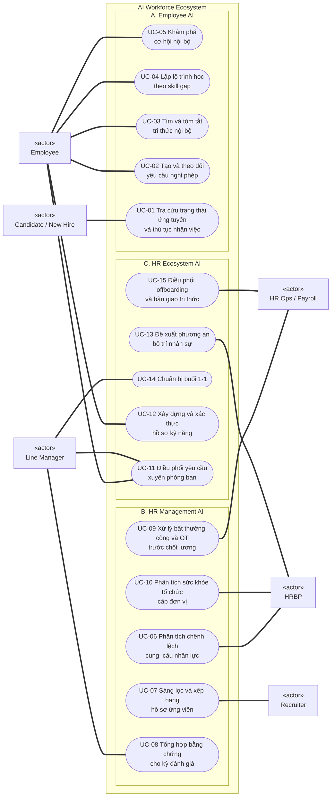

# AI Workforce Ecosystem: Tài liệu

Bộ tài liệu cho hệ sinh thái AI hỗ trợ nhân viên, HR và lãnh đạo trong một tập đoàn IT lớn.

## Cấu trúc

```text
docs/
├── 01-overview/            Bối cảnh, bài toán, mục tiêu
├── 02-product-mindmap/     Feature và thành phần sản phẩm
└── 03-use-cases/           Danh mục, sơ đồ, đặc tả use case
```

## 1. Overview

**Bài toán:** xây dựng AI-powered Workforce Ecosystem giúp nhân viên làm việc hiệu quả hơn, đồng thời hỗ trợ HR và lãnh đạo quản trị, phân bổ và tối ưu nguồn nhân lực toàn tập đoàn.

| Mục tiêu | Ý nghĩa |
|---|---|
| Empower Employees | Giúp nhân viên tự giải quyết nhu cầu, thực hiện công việc, tiếp cận tri thức, phát triển kỹ năng và nâng cao năng suất, lộ trình sự nghiệp; giảm thao tác thủ công và phụ thuộc vào HR. |
| Augment HR & Management | Hỗ trợ HR, Manager và lãnh đạo quản trị nguồn nhân lực, phân tích dữ liệu, ra quyết định, chuẩn hóa quy trình và giảm tải vận hành |
| Automate Workflows | Chuẩn hóa và tự động hóa quy trình xuyên phòng ban |
| Optimize Workforce | Khai thác kỹ năng nội bộ, điều chuyển linh hoạt, giữ chân nhân tài |


Chi tiết: [AI_Workforce_Ecosystem.md](01-overview/AI_Workforce_Ecosystem.md)

## 2. Product mindmap

9 feature chính; mỗi nhánh gồm thành phần AI và điểm con người quyết định.


| File | Nội dung |
|---|---|
| [Product_Mindmap.md](02-product-mindmap/Product_Mindmap.md) | Mindmap dạng outline |
| [Product_Mindmap_Detail.md](02-product-mindmap/Product_Mindmap_Detail.md) | Giải thích từng thành phần, gắn nhãn `[AI]`, `[Rules]`, `[Người]` |
| [Product_Mindmap.html](02-product-mindmap/Product_Mindmap.html) | Bản HTML (mở bằng trình duyệt) |

## 3. Use case

15 use case, chia 3 nhóm: **A. Employee AI** (UC-01 đến 05), **B. HR Management AI** (UC-06 đến 10), **C. HR Ecosystem AI** (UC-11 đến 15). Đường đậm là actor chính. Line Manager cũng là Employee nên làm được mọi use case của Employee.



| File | Nội dung |
|---|---|
| [UC_01_Catalog.md](03-use-cases/UC_01_Catalog.md) | Bảng 15 use case, actor, phân vai AI/rules/người |
| [UC_02_Diagrams.md](03-use-cases/UC_02_Diagrams.md) | Sơ đồ theo từng nhóm và quan hệ include/extend |
| [UC_03_Specifications.md](03-use-cases/UC_03_Specifications.md) | Đặc tả chi tiết từng use case |
